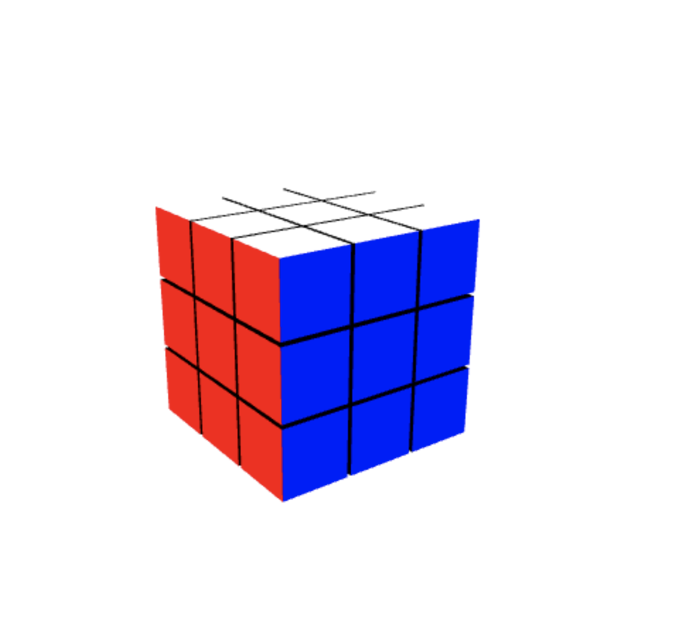

# 🧩 Rubik's Cube in Angular & Three.js

Um projeto interativo de Cubo Mágico 3D desenvolvido com **Angular** e **Three.js**, permitindo visualizar, girar e interagir com o cubo diretamente no navegador.



---

## ✨ Funcionalidades

- **Renderização 3D Realista:** Cubo Mágico modelado e renderizado via WebGL com Three.js.
- **Interatividade Completa:** Rotação livre da câmera (órbita) e rotação das camadas do cubo.
- **Animações Suaves:** Transições fluidas para os movimentos das faces.
- **Arquitetura Modular:** Organizado em componentes e serviços reutilizáveis do Angular.
- *(Opcional)* **Embaralhamento e Resolução:** Botão para embaralhar o cubo automaticamente.

---

## 🚀 Tecnologias Utilizadas

- [Angular](https://angular.io/) - Framework principal para a estrutura da aplicação.
- [Three.js](https://threejs.org/) - Biblioteca JavaScript para gráficos 3D baseada em WebGL.
- [TypeScript](https://www.typescriptlang.org/) - Superset JavaScript tipado.
- HTML5 / SCSS - Estilização e layout da interface.

---

## 📦 Pré-requisitos

Certifique-se de ter instalado em sua máquina:
- [Node.js](https://nodejs.org/) (versão 18+ recomendada)
- Angular CLI (`npm install -g @angular/cli`)

---

## ⚙️ Instalação e Execução

Siga os passos abaixo para rodar o projeto localmente:

1. **Clone o repositório:**
```bash
   git clone https://github.com/YuriBaena/RubiksCube.git

```

2. **Entre na pasta do projeto:**
```bash
cd RubiksCube

```


3. **Instale as dependências:**
```bash
npm install

```


4. **Execute o servidor de desenvolvimento:**
```bash
ng serve

```


---

## 🎯 Próximos Passos / Melhorias Futuras

* [ ] Implementar um algoritmo de resolução automática (como o Algoritmo de Kociemba).
* [ ] Adicionar sistema de pontuação e cronômetro (Speedcubing).
* [ ] Adicionar sons realistas de giro das peças.

---

## 🤝 Contribuindo

Contribuições são sempre bem-vindas! Sinta-se à vontade para abrir uma *issue* ou enviar um *pull request*.

1. Faça um Fork do projeto
2. Crie uma Branch para sua Feature (`git checkout -b feature/NovaFeature`)
3. Faça o Commit das alterações (`git commit -m 'Adicionando nova feature'`)
4. Faça o Push para a Branch (`git push origin feature/NovaFeature`)
5. Abra um Pull Request

---

Feito por __Yuri Baena__.
